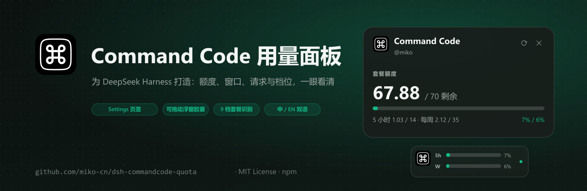
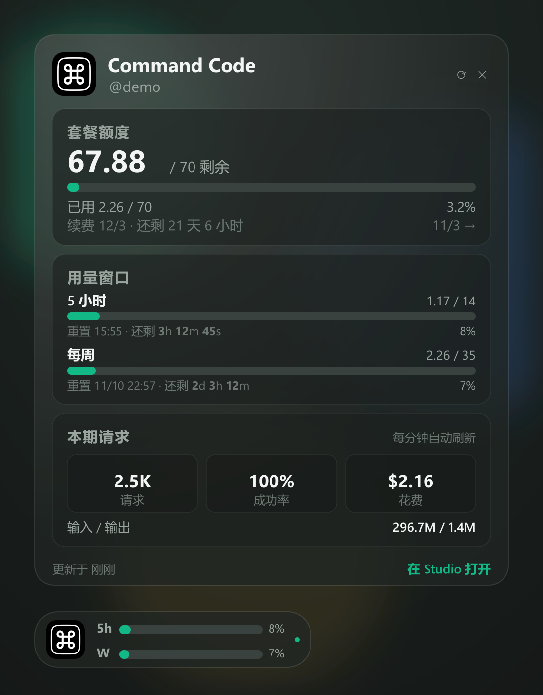
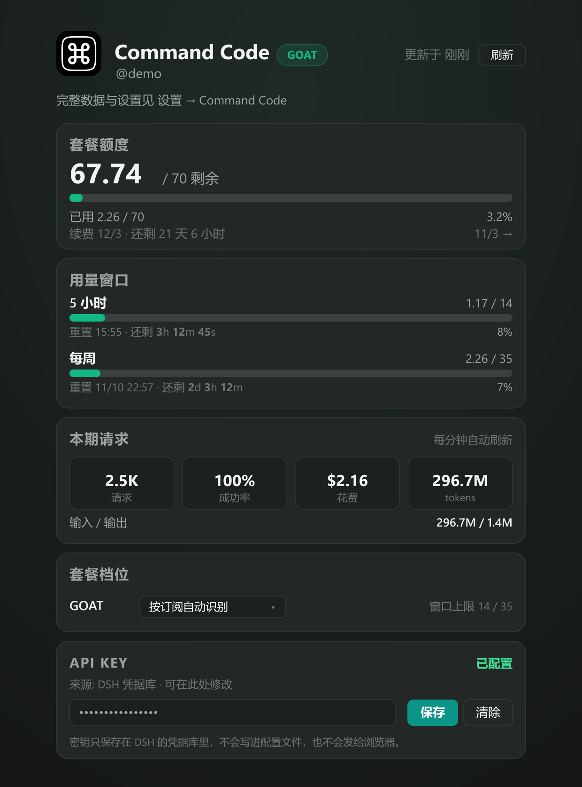
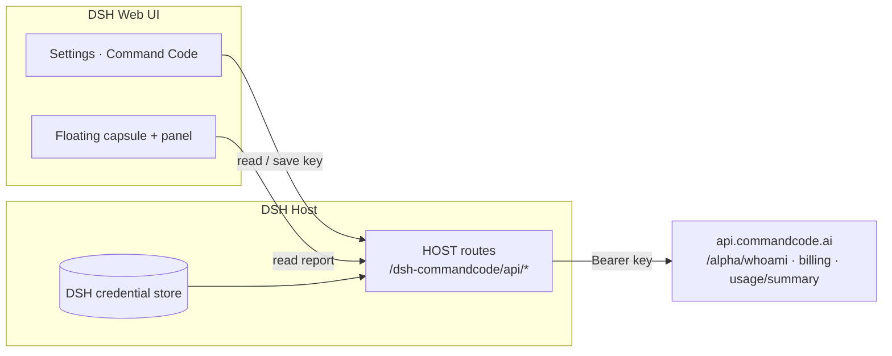

<p align="center">
  
</p>

<h1 align="center">Command Code usage panel</h1>

<p align="center">
  See your Command Code credits, limits and request stats without leaving DeepSeek Harness.
</p>

<p align="center">
  <a href="README.md">简体中文</a> · <b>English</b>
</p>

<p align="center">
  <a href="https://www.npmjs.com/package/@yumiku/dsh-commandcode-quota"></a>
  <a href="https://github.com/miko-cn/dsh-commandcode-quota/actions/workflows/ci.yml"></a>
  
  <a href="LICENSE"></a>
  <a href="https://github.com/deepseek-ai/deepseek-harness"></a>
</p>

---

## What is it

If you run models through Command Code, you probably open its website a few times a day just to check "how much of this month's credits is left, and how close am I to the 5-hour limit".

This plugin moves that into DeepSeek Harness:

- **a Settings page** with credits, limits and request stats in one place;
- **a floating capsule** that stays on screen with two progress bars and a live countdown;
- click the capsule for the full panel; drag it anywhere;
- no second login, no tab switching.

## What it looks like

<p align="center">
  
  &nbsp;
  
</p>

<p align="center"><sub>Left: the panel · Right: Settings → Command Code</sub></p>

## Get started in a minute

### 1. Install

```pwsh
dsh plugin --profile <profile> add @yumiku/dsh-commandcode-quota
```

Or ask the agent in a DSH session to run `plugin_manager` → `install_bundle` with `@yumiku/dsh-commandcode-quota`.

### 2. Add an API key (usually not needed)

- If you have signed in with `cmd login`, or DSH already uses Command Code as its model provider, the plugin reuses that key — **skip this step**.
- Otherwise: **Settings → Command Code → API key**, or open the floating capsule and paste it right there (the capsule shows the field when no key is configured).

The key lives in the DSH credential store only — never in config files, never sent to the browser.

### 3. Reload the page

A "Command Code" tab appears in Settings, and the floating capsule shows up at the bottom right — drag it wherever you like.

<details>
<summary>Other ways to install (GitHub Release / self-hosted index)</summary>

Prebuilt package from GitHub Releases:

```text
https://github.com/miko-cn/dsh-commandcode-quota/releases/latest/download/dsh-commandcode-quota.tgz
```

If you run the official custom-index bundle, add this to **Plugins → Discover → Manage index sources** and install from Discover:

```text
https://raw.githubusercontent.com/miko-cn/dsh-commandcode-quota/main/market/index.json
```

</details>

## What the numbers mean

### Plan credits

Command Code's monthly credits are one pool. The panel shows remaining / total in credits, the used percentage, the billing-cycle range, and **how long until renewal** (e.g. "Cycle 11/3 – 12/3 · 25d 1h left"). Credits reset monthly and do not roll over; purchased and free credits are listed separately.

### 5-hour / weekly windows

Besides the monthly pool, Command Code paces you with two rolling limits: how much you may spend in **any 5 hours** and **any 7 days**. They do not reset on calendar boundaries — a window starts with your first request.

The two bars in the capsule are exactly these windows, with a live countdown on the right:

- 5-hour window: `3h 12m 45s` (the seconds tick — that is the countdown, not a data refresh)
- weekly window: `2d 3h 12m`

A leading zero unit is dropped, e.g. `59m 59s`.

### Requests this period

Counted per billing period: requests, success rate, spend, input/output tokens. Opening the panel forces a refresh; after that it updates every minute. The footer shows "updated X seconds ago".

### Plan tier

The plugin detects your plan automatically (Go / GOAT / Pro / Max / Ultra / Teams Pro); window caps come from Command Code live. You can override the tier in Settings — it only changes display and conversions, never your subscription.

### The floating capsule

- Drag it anywhere; the position is remembered;
- loads on startup (skeleton bars first, never silently empty);
- refreshes when you switch back to DSH;
- turns amber at 70% and red at 90% for credits or either window;
- hide it from the Settings page if you prefer.

## FAQ

**Do I need another account?**
No — your existing Command Code account is enough.

**Is my API key uploaded anywhere?**
No. The key is only used by the DSH host process; the browser only receives the shaped numbers.

**Why 14 / 35?**
Those are GOAT's 5-hour and weekly caps in credits. Other tiers have different caps, and the panel always shows the live value for your plan. Credits are not dollars: on full-allowance models 1 credit ≈ $1 of usage, while high-allowance models convert at their own rate.

**The numbers differ from the website.**
The panel counts per billing period and the website can lag a few minutes; hit refresh or reopen the panel to force the latest values.

**The capsule disappeared.**
Open **Settings → Command Code** and turn "Show the floating widget" back on.

**I see `Failed to load plugins` on startup.**
A 1.0.2 issue (an undeclared client service); fixed in 1.0.4 — upgrade to the latest version.

**Does it hammer the API?**
It refreshes when you open the panel, every minute while it is open, and every 5 minutes by default in the background capsule (1–10 minutes, configurable in Settings); nothing runs while the page is hidden. Each refresh calls 4 Command Code endpoints.

**Is there a Chinese UI?**
Yes. UI text follows the DSH language setting (Chinese and English are bundled), and this README has a [Chinese version](README.md).

## Configuration

Usually you do not need this. To tune it, add to the profile's `cordis.patch.yml`:

```yaml
- id: commandcode-quota
  name: '@yumiku/dsh-commandcode-quota'
  config:
    apiKey: ''                 # empty = auto-detect; prefer the Settings page
    apiKeyEnv: COMMAND_CODE_API_KEY
    apiBase: https://api.commandcode.ai
    planOverride: ''           # default tier; the Settings choice wins
    cacheMs: 45000             # background cache (opening the panel bypasses it)
    timeoutMs: 12000
```

<details>
<summary>API key lookup order</summary>

1. The key saved from the Settings page (DSH credential store, `COMMAND_CODE_API_KEY`)
2. Environment variable `COMMAND_CODE_API_KEY` (renameable via `apiKeyEnv`)
3. Environment variables `COMMANDCODE_API_KEY`, `COMMAND_API_KEY`
4. `~/.commandcode/auth.json` (written by `cmd login`)
5. `~/.dsh/.credentials.yaml`

</details>

## How it works



The host process calls Command Code's internal endpoints (the same ones the `cmd` CLI's `/usage` view uses), shapes one report and serves it on same-origin routes; the page only reads that report. Both routes go through DSH's request gate.

| Route | Purpose |
| --- | --- |
| `GET /dsh-commandcode/api/report` | account, credits, windows, period requests (`?refresh=1` bypasses cache) |
| `GET /dsh-commandcode/api/key` | whether a key is configured, its source, whether it is writable (never the value) |
| `POST /dsh-commandcode/api/key` | save / clear the key (into the DSH credential store) |

## Development

Plain JavaScript, no build step:

```pwsh
node --check index.js
node --check client.js
node test/test-client.mjs          # stubbed browser: slot registration, settings, capsule, popover
node test/test-host.mjs <api-key>  # real API: report + key status
node scripts/check-locales.mjs     # zh/en string parity
```

README artwork is rendered by `scripts/make-assets.mjs` (needs sharp):

```pwsh
$env:SHARP_PATH='<path-to-node_modules>/sharp'; node scripts/make-assets.mjs
```

## Publishing

- **npm**: `@yumiku/dsh-commandcode-quota`, `npm publish` (`publishConfig.access=public`)
- **CI**: syntax, manifest, client smoke test and `npm pack --dry-run` on every push / PR
- **Release**: pushing a `v*` tag packs the plugin and creates a GitHub Release with a version-free `dsh-commandcode-quota.tgz`
- **Marketplace**: submission draft in [`marketplace/awesome-dsh-plugin.yml`](marketplace/awesome-dsh-plugin.yml)
- **Self-hosted Discover index**: `market/index.json` (generated by `scripts/build-index.mjs`)

## Known limitations

- Per-request details only exist behind Command Code Studio's signed-in web API (cookie-based), so the panel shows period summaries only.
- Command Code's `/alpha/*` endpoints are internal to its CLI and have no public stability promise; missing fields degrade instead of breaking the panel.
- Command Code is a third-party service; this plugin is an unofficial dashboard for it.

## License

[MIT](LICENSE)
