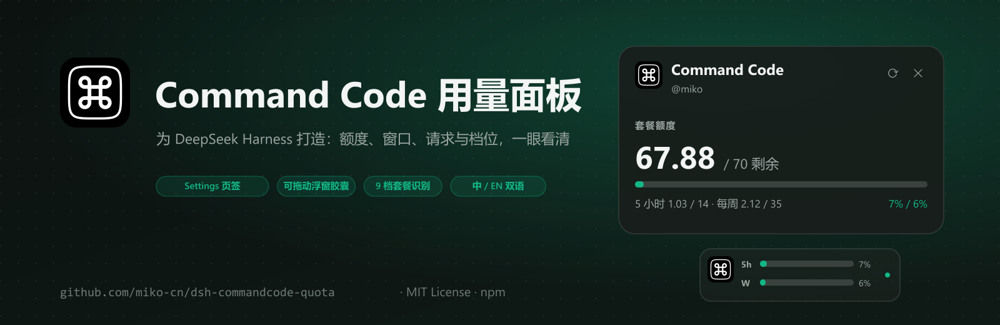
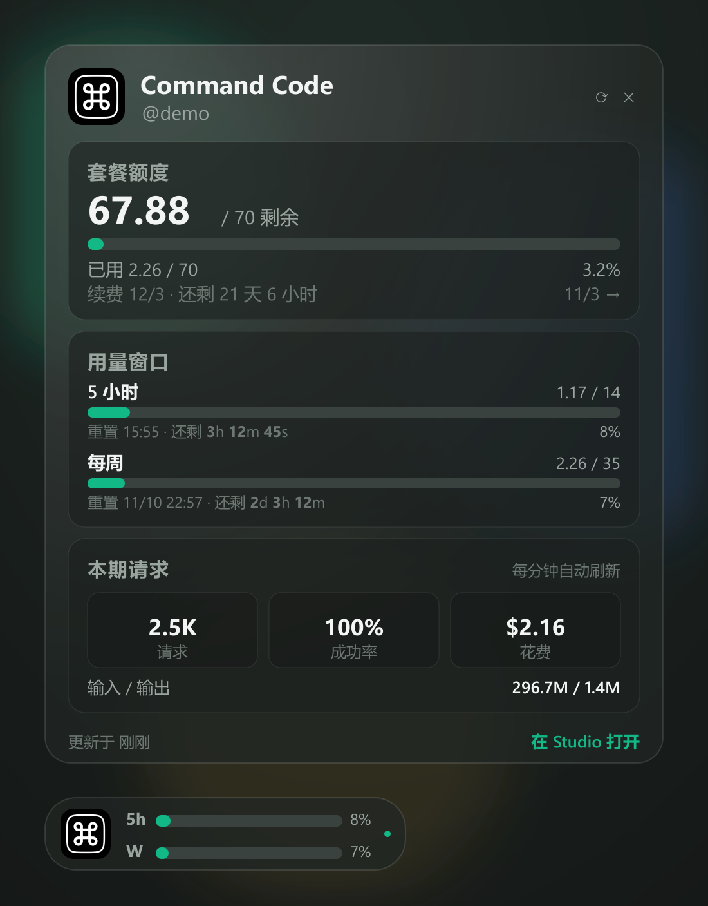
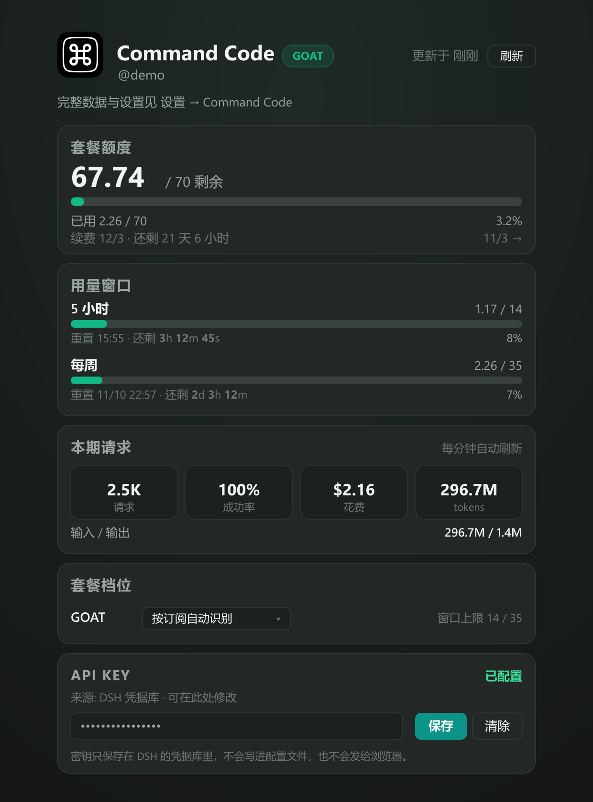
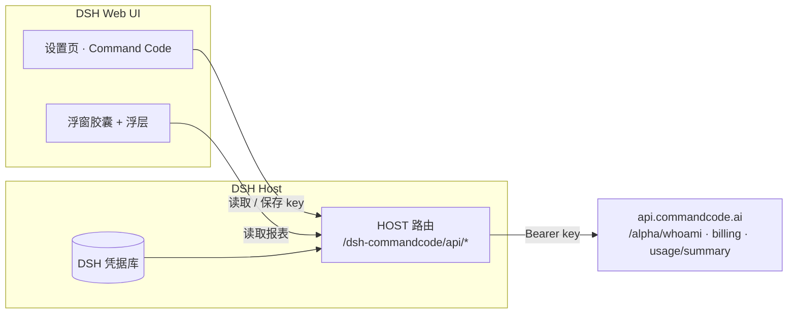

<p align="center">
  
</p>

<h1 align="center">Command Code 用量面板</h1>

<p align="center">
  在 DeepSeek Harness 里，一眼看到 Command Code 的额度、窗口和请求量。
</p>

<p align="center">
  <b>简体中文</b> · <a href="README.en.md">English</a>
</p>

<p align="center">
  <a href="https://www.npmjs.com/package/@yumiku/dsh-commandcode-quota"></a>
  <a href="https://github.com/miko-cn/dsh-commandcode-quota/actions/workflows/ci.yml"></a>
  
  <a href="LICENSE"></a>
  <a href="https://github.com/deepseek-ai/deepseek-harness"></a>
</p>

---

## 这是什么

如果你用 Command Code 跑模型，大概每天都会做同一件事：切到它的网站，看一眼「这个月还剩多少额度、5 小时窗口用了多少」。

这个插件把这件事搬进 DSH：

- **一个设置页**：额度、窗口、本期请求，一次看全；
- **一个浮窗胶囊**：常驻在桌面上，双行进度条 + 倒计时，扫一眼就知道还剩多少；
- 点一下胶囊展开完整面板，可以拖到屏幕任意位置；
- 不用第二次登录，也不用离开 DSH。

## 长什么样

<p align="center">
  
  &nbsp;
  
</p>

<p align="center"><sub>左：点开胶囊后的面板 · 右：设置里的 Command Code 页面</sub></p>

## 一分钟上手

### 1. 安装

```pwsh
dsh plugin --profile <profile> add @yumiku/dsh-commandcode-quota
```

也可以在 DSH 会话里让 agent 用 `plugin_manager` 的 `install_bundle` 安装 `@yumiku/dsh-commandcode-quota`。

### 2. 填 API key（多数人不需要）

- 如果你用过 `cmd login`，或者 DSH 本身正在用 Command Code 当模型供应商，插件会自动复用，**跳过这步**。
- 否则：**设置 → Command Code → API key**，或者点开浮窗直接粘贴保存（没配 key 时浮窗里就有输入框）。

key 只存在 DSH 的凭据库里：不写配置文件，也不会发给浏览器页面。

### 3. 刷新页面

设置里会多出一个「Command Code」，桌面右下角会出现浮窗胶囊——直接拖到你喜欢的位置。

<details>
<summary>其他安装方式（GitHub Release / 自建索引）</summary>

GitHub Release 的预构建包：

```text
https://github.com/miko-cn/dsh-commandcode-quota/releases/latest/download/dsh-commandcode-quota.tgz
```

如果启用了官方的「自定义插件索引 / Discover」，也可以把下面这个地址加进 **Plugins → Discover → Manage index sources**，然后在 Discover 里搜索安装：

```text
https://raw.githubusercontent.com/miko-cn/dsh-commandcode-quota/main/market/index.json
```

</details>

## 每个数字是什么意思

### 套餐额度

Command Code 的月额度是一个池子。面板显示「剩余 / 总额度 credits」、已用百分比，以及**本期的起止时间和距离续费还剩多久**（比如「本期 11/3 – 12/3 · 还剩 25d 1h」）。额度按月重置、不结转；额外买的额度、赠送的额度会单独列出。

### 5 小时 / 每周窗口

Command Code 除了月额度，还有两道「限速」：**任意 5 小时**、**任意 7 天**内最多能花多少。它们不是按自然日重置，而是从你第一笔请求开始计时。

浮窗和面板上的两行进度条就是这两个窗口，右边是实时倒计时：

- 5 小时窗口：`3h 12m 45s`（每秒跳动的是倒计时，不是数据刷新）
- 每周窗口：`2d 3h 12m`

高位为 0 会省略，比如只剩 59 分钟时显示 `59m 59s`。

### 本期请求

按计费周期统计：发了多少请求、成功率、花了多少钱、输入 / 输出 token 多少。打开面板时会强制刷新一次，之后每分钟自动更新；面板底部会显示「更新于 X 秒前」。

### 套餐档位

插件会自动识别你的套餐（Go / GOAT / Pro / Max / Ultra / Teams Pro），窗口上限以 Command Code 实时返回为准。设置页里也可以手动切换档位——只影响显示和换算，不会改动你的订阅。

### 浮窗

- 拖到任意位置，位置会记住；
- 启动时自动加载（先显示骨架条，不会一直空着）；
- 从别的窗口切回 DSH 时会自动刷新；
- 额度或窗口用到 70% 时浮窗变琥珀色、90% 时变红色；
- 不想看可以在设置页里关掉。

## 常见问题

**需要额外注册吗？**
不用。用你原本的 Command Code 账号就行。

**API key 会被上传吗？**
不会。key 只在 DSH 的后台进程里使用，浏览器页面只拿到整理好的数字，拿不到 key 本身。

**为什么 5 小时是 14、每周是 35？**
这是 GOAT 套餐的窗口上限（单位是 credits）。不同档位的上限不一样，面板会显示你当前档位的实际值。credits 也不等于美元：对全额额度模型 1 credit ≈ $1 用量，对高额度模型按倍率折算。

**数字和官网对不上？**
面板按计费周期统计，官网可能有几分钟延迟；点击刷新或重新打开面板会强制拉取最新值。

**浮窗不见了？**
去 **设置 → Command Code**，把「显示桌面浮窗」重新打开。

**启动时提示 `Failed to load plugins`？**
这是 1.0.2 的已知问题（客户端服务没有声明 inject），1.0.4 起已修复；升级到最新版本即可。

**会不会很耗接口？**
打开面板时刷新一次，之后每分钟一次；浮窗后台默认 5 分钟一次（设置里可调 1–10 分钟）；页面不可见时不会请求。每轮会调 Command Code 的 4 个接口。

**有英文界面吗？**
有。界面文案跟随 DSH 的语言设置自动切换（内置中 / 英两套），这个 README 也有[英文版](README.en.md)。

## 配置

平时不需要改。想调整的话，在 profile 的 `cordis.patch.yml` 里加：

```yaml
- id: commandcode-quota
  name: '@yumiku/dsh-commandcode-quota'
  config:
    apiKey: ''                 # 留空则自动查找；推荐用设置页写入凭据库
    apiKeyEnv: COMMAND_CODE_API_KEY
    apiBase: https://api.commandcode.ai
    planOverride: ''           # 默认档位，页面上的手动选择优先生效
    cacheMs: 45000             # 后台缓存时长（打开面板时会强制刷新）
    timeoutMs: 12000
```

<details>
<summary>API key 的查找顺序</summary>

1. 设置页保存的 key（DSH 凭据库，`COMMAND_CODE_API_KEY`，优先于环境变量）
2. 环境变量 `COMMAND_CODE_API_KEY`（`apiKeyEnv` 可改名）
3. 环境变量 `COMMANDCODE_API_KEY`、`COMMAND_API_KEY`
4. `~/.commandcode/auth.json`（`cmd login` 生成）
5. `~/.dsh/.credentials.yaml`

</details>

## 它是怎么工作的



DSH 的后台进程拿着 API key 去调 Command Code 的内部接口（和 `cmd` CLI 的 `/usage` 同源），整理成一份报表挂在同源路由上；网页只读报表。两个路由都走 DSH 的请求门禁。

| 路由 | 作用 |
| --- | --- |
| `GET /dsh-commandcode/api/report` | 账号、额度、窗口、本期请求（`?refresh=1` 强制刷新） |
| `GET /dsh-commandcode/api/key` | key 是否配置、来源、是否可写（不含值） |
| `POST /dsh-commandcode/api/key` | 保存 / 清除 key（写入 DSH 凭据库） |

## 开发

仓库是纯 JavaScript，没有构建步骤：

```pwsh
node --check index.js
node --check client.js
node test/test-client.mjs          # 桩浏览器环境：槽位注册、设置页、浮窗、浮层
node test/test-host.mjs <api-key>  # 真实接口：报表 + key 状态
node scripts/check-locales.mjs     # 中英文案 key 对齐
```

README 里的图片由 `scripts/make-assets.mjs` 渲染，需要 sharp：

```pwsh
$env:SHARP_PATH='<path-to-node_modules>/sharp'; node scripts/make-assets.mjs
```

## 发布

- **npm**：`@yumiku/dsh-commandcode-quota`，`npm publish`（`publishConfig.access=public`）
- **CI**：push / PR 跑语法检查、manifest 校验、客户端冒烟测试、`npm pack --dry-run`
- **Release**：推 `v*` 标签自动 `npm pack` 并创建 GitHub Release，资产名固定为 `dsh-commandcode-quota.tgz`
- **插件市场**：投稿草稿见 [`marketplace/awesome-dsh-plugin.yml`](marketplace/awesome-dsh-plugin.yml)
- **自建 Discover 索引**：`market/index.json`（`node scripts/build-index.mjs` 生成）

## 已知限制

- 逐条请求明细只存在于 Command Code Studio 的登录会话接口（需要网页 cookie），API key 拿不到，所以面板只做本期汇总。
- Command Code 的 `/alpha/*` 是 CLI 内部接口，没有公开稳定性承诺；字段缺失时面板会降级显示而不是报错。
- Command Code 是第三方服务，本插件只是它的数据看板，与官方无隶属关系。

## License

[MIT](LICENSE)
