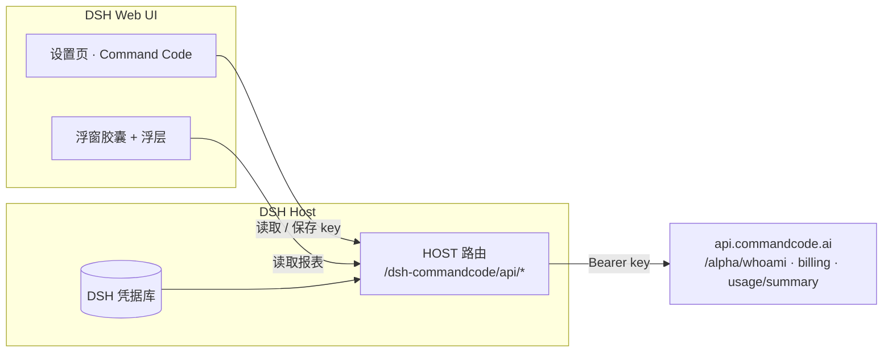

<p align="center">
  
</p>

<h1 align="center">Command Code 用量面板</h1>

<p align="center">
  <a href="https://www.npmjs.com/package/@yumiku/dsh-commandcode-quota"></a>
  <a href="https://github.com/miko-cn/dsh-commandcode-quota/actions/workflows/ci.yml"></a>
  
  <a href="LICENSE"></a>
</p>

<h3 align="center">在 DeepSeek Harness 里，直接看 Command Code 的额度、窗口和请求量。</h3>

<p align="center">
  一个设置页 · 一个可拖动的浮窗胶囊 · 9 档套餐识别 · 内置 API key 管理
</p>

---

## 亮点

| | |
| --- | --- |
| 💳 **套餐额度** | 本期剩余 / 总额度、已用百分比、续费日期，额外购买的额度单独列出 |
| ⏱ **滚动窗口** | 5 小时与每周窗口的已用 / 上限 / 重置时刻，实时值来自 Command Code 接口 |
| 📊 **本期请求** | 请求数、成功率、花费、输入输出 token，打开即刷新、此后每分钟更新 |
| 🎚 **套餐档位** | 自动按订阅识别 Go / GOAT / Pro / Max / Ultra / Teams Pro，也可手动指定 |
| 🪟 **桌面浮窗** | 液态毛玻璃外壳的胶囊：Logo + 双行进度条，拖到任意位置，位置本地记忆，点开是完整浮层 |
| 🔑 **API key** | 设置页直接填写 / 清除，写入 DSH 凭据库，不落配置文件、不下发浏览器 |

## 界面

<p align="center">
  
  &nbsp;&nbsp;
  
</p>

<p align="center"><sub>左：液态毛玻璃浮层 + 双行进度条浮窗胶囊 · 右：设置 → Command Code 页面</sub></p>

## 快速开始

**1. 安装插件**

```pwsh
dsh plugin --profile <profile> add @yumiku/dsh-commandcode-quota
```

或在 DSH 会话里用 `plugin_manager`：`install_bundle`，`target` 填 `@yumiku/dsh-commandcode-quota`。
npm 尚未发布时，也可以直接装 GitHub Release 的预构建包：

```text
https://github.com/miko-cn/dsh-commandcode-quota/releases/latest/download/dsh-commandcode-quota.tgz
```

**2. 配置 API key**

如果你已经用 `cmd login` 登录过，或者 DSH 正在用 Command Code 作为模型供应商（`COMMAND_API_KEY`），插件会自动复用，无需配置。
否则打开 **设置 → Command Code → API key**，粘贴一个 Command Code API key 保存即可——密钥只写入 DSH 凭据库。

**3. 刷新页面**

设置里出现「Command Code」页签，桌面上出现浮窗胶囊。

## 面板里都有什么

### 套餐额度

Command Code 的月额度是一个池子，面板显示「剩余 / 总额度」和已用百分比。额度按月重置、不结转；额外购买的额度、赠送额度会单独显示。

### 5 小时 / 每周窗口

Command Code 在月额度之上还有两个**滚动窗口**，用来限速：

- **5 小时窗口**：任意 5 小时内最多能用多少 credits（GOAT 是 14）
- **每周窗口**：任意 7 天内最多能用多少 credits（GOAT 是 35）

窗口**从你第一笔请求开始计时**，5 小时 / 7 天后整段归零，不是按自然日重置。面板显示每个窗口的已用、上限、重置时刻和百分比。`credits` 不等于美元：对全额额度模型 1 credit ≈ $1 用量，对高额度模型按倍率折算，所以同样的「14」在不同模型组合下对应的美元不同。

### 本期请求

按**计费周期**统计：请求数、成功率、花费、输入 / 输出 token。打开面板时强制刷新（绕过本地缓存），之后每分钟自动刷新一次；面板底部显示「更新于 X 秒前」。

### 套餐档位

插件内置 9 个档位（`individual-go`、`individual-goat`、`individual-pro`、`individual-max`、`individual-ultra`、`teams-pro`、`individual-provider` 等），默认从订阅的 `planId` 自动识别，档位表提供月额度与窗口上限的兜底值；窗口上限以接口实时返回为准。设置页可以手动切换档位（只影响显示与换算，不会改动你的订阅）。

## 配置

```yaml
- id: commandcode-quota
  name: '@yumiku/dsh-commandcode-quota'
  config:
    apiKey: ''                 # 留空则自动查找；推荐用设置页写入凭据库
    apiKeyEnv: COMMAND_CODE_API_KEY
    apiBase: https://api.commandcode.ai
    planOverride: ''           # 默认档位，页面上的手动选择优先生效
    cacheMs: 45000             # Host 侧缓存时长（打开面板时强制刷新）
    timeoutMs: 12000
```

### API key 解析顺序

1. 设置页保存的 key（DSH 凭据库，`COMMAND_CODE_API_KEY`，优先于环境变量）
2. 环境变量 `COMMAND_CODE_API_KEY`（`apiKeyEnv` 可改名）
3. 环境变量 `COMMANDCODE_API_KEY`、`COMMAND_API_KEY`
4. `~/.commandcode/auth.json`（`cmd login` 生成）
5. `~/.dsh/.credentials.yaml`

## 架构



数据流很简单：Host 半拿着 API key 调 Command Code 的内部接口（与 `cmd` CLI 的 `/usage` 同源），整理成一份报表挂在同源路由上；客户端半只读报表，**永远拿不到 key**。两个路由都过 DSH 的请求门禁。

| 路由 | 作用 |
| --- | --- |
| `GET /dsh-commandcode/api/report` | 账号、额度、窗口、本期请求（`?refresh=1` 强制刷新） |
| `GET /dsh-commandcode/api/key` | key 是否配置、来源、是否可写（不含值） |
| `POST /dsh-commandcode/api/key` | 保存 / 清除 key（写入 DSH 凭据库） |

## 开发

仓库是纯 JavaScript，无需构建：

```pwsh
node --check index.js
node --check client.js
node test/test-client.mjs          # 桩浏览器环境：槽位注册、设置页、浮窗、浮层
node test/test-host.mjs <api-key>  # 真实接口：报表 + key 状态
```

界面素材（banner、预览图）由 `scripts/make-assets.mjs` 渲染，需要 sharp：

```pwsh
$env:SHARP_PATH='<path-to-node_modules>/sharp'; node scripts/make-assets.mjs
```

## 发布

- **npm**：`@yumiku/dsh-commandcode-quota`，`npm publish`（`publishConfig.access=public`）
- **CI**：push / PR 跑语法检查、manifest 校验、客户端冒烟测试、`npm pack --dry-run`
- **Release**：推 `v*` 标签自动 `npm pack` 并创建 GitHub Release，资产名固定为 `dsh-commandcode-quota.tgz`
- **插件市场**：投稿草稿见 [`marketplace/awesome-dsh-plugin.yml`](marketplace/awesome-dsh-plugin.yml)

## 已知限制

- 逐条请求明细只存在于 Command Code Studio 的登录会话接口（`/internal/usage*`，需要网页 cookie），API key 拿不到，所以面板只做本期汇总。
- `/alpha/*` 是 CLI 内部接口，未在公开文档中承诺稳定性；字段缺失时面板会降级显示而不是报错。
- Command Code 是第三方服务，本插件只是它的数据看板，与 Command Code 官方无隶属关系。

## License

[MIT](LICENSE)

---

[](https://github.com/deepseek-ai/deepseek-harness)
